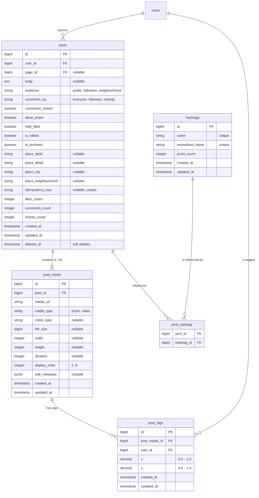

# ARCHITECTURE TECHNIQUE DU MODULE CR1 SQUARE — BANGO

## 1. Principes Directeurs
- **Séparation des responsabilités** : Contrôleurs minces (orchestration HTTP), FormRequests dédiées (validation), Services métier spécialisés (logique d'affaires, transactions), Policies (autorisation d'accès), Resources (normalisation des réponses JSON).
- **Intégrité et Atomicité** : Toute création de publication est encapsulée dans une transaction de base de données (`DB::transaction`). Si l'attachement d'un média, d'un tag ou d'un hashtag échoue, l'intégralité du post est annulée.
- **Idempotence & Anti-Duplication** : Utilisation d'un index unique sur `idempotency_key` pour garantir qu'un retry réseau du frontend ne génère pas de doublon.
- **Sécurité & Protection IDOR** : Seul l'auteur d'un post (ou un administrateur ayant le rôle adéquat) peut modifier la légende, l'audience, le statut des commentaires, archiver ou supprimer son post (`PostPolicy`).
- **Support des Médias** : Validation stricte des types MIME (photos jpeg, png, webp ; vidéos mp4, mov), limitation de taille (15MB par photo, 100MB par vidéo), calcul automatique des dimensions si nécessaire, stockage sur le disque public sécurisé.

---

## 2. Arborescence Cible

```
app/
├── Enums/
│   └── Square/
│       ├── PostAudience.php          // 'public', 'followers', 'neighbourhood'
│       ├── PostCommentsBy.php        // 'everyone', 'followers', 'nobody'
│       └── PostMediaKind.php         // 'photo', 'video'
├── Http/
│   ├── Controllers/
│   │   └── Api/
│   │       └── V1/
│   │           ├── Square/
│   │           │   ├── PostController.php               // store, show, destroy
│   │           │   ├── PostFeedController.php           // index (feed paginé)
│   │           │   ├── PostCaptionController.php        // update (caption)
│   │           │   ├── PostAudienceController.php       // update (audience)
│   │           │   ├── PostCommentsStatusController.php // update (comments-status)
│   │           │   └── PostArchiveController.php        // archive, unarchive
│   │           ├── Media/
│   │           │   └── MediaUploadController.php        // upload
│   │           └── Search/
│   │               ├── PeopleSearchController.php       // search people
│   │               ├── HashtagSearchController.php      // search trending hashtags
│   │               └── PlaceSearchController.php        // search places
│   ├── Requests/
│   │   └── Api/
│   │       └── V1/
│   │           ├── Square/
│   │           │   ├── CreatePostRequest.php
│   │           │   ├── UpdateCaptionRequest.php
│   │           │   ├── UpdateAudienceRequest.php
│   │           │   └── UpdateCommentsStatusRequest.php
│   │           └── Media/
│   │               └── UploadMediaRequest.php
│   └── Resources/
│       └── Api/
│           └── V1/
│               ├── Square/
│               │   ├── PostResource.php
│               │   ├── PostMediaResource.php
│               │   └── PostTagResource.php
│               └── Search/
│                   ├── PeopleSearchResultResource.php
│                   └── HashtagSearchResultResource.php
├── Models/
│   ├── Post.php
│   ├── PostMedia.php
│   ├── PostTag.php
│   └── Hashtag.php
├── Policies/
│   └── PostPolicy.php
├── Services/
│   ├── Square/
│   │   ├── PostCreationService.php
│   │   ├── PostFeedService.php
│   │   ├── PostManagementService.php
│   │   └── HashtagExtractionService.php
│   └── Media/
│       └── MediaUploadService.php
routes/
├── api.php
└── api/
    └── v1/
        ├── square.php
        ├── media.php
        └── search.php
```

---

## 3. Schéma Relationnel


