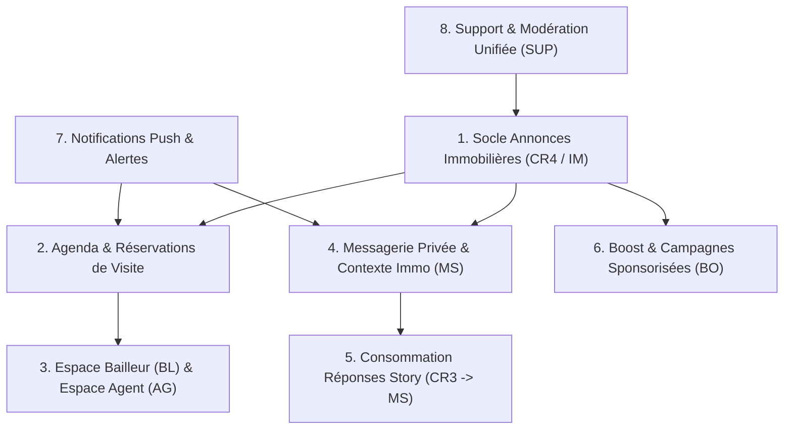

# Synthèse Globale de l'Audit de Couverture API — BANGO

**Projet :** BANGO Mobile (React Native / Expo) & BANGO Backend (Laravel 12 / PHP 8.4)  
**Date de finalisation :** 15 Octobre 2026  
**Auteur de l'audit :** Pair-Programmer & Auditeur Architecture BANGO  
**Documents de référence associés :**
- `docs/audit/frontend_modules_inventory.md`
- `docs/audit/backend_api_inventory.md`
- `docs/audit/module_api_coverage.md`
- `docs/audit/missing_backend_apis.md`
- `docs/audit/backend_apis_without_frontend_mapping.md`
- `docs/audit/bl_ag_real_estate_messaging.md`

---

## 1. Synthèse Chiffrée Globale

| Indicateur d'Évaluation | Valeur Relevée | Méthode & Périmètre de Comptage |
| :--- | :--- | :--- |
| **Modules frontend de premier niveau** | **21 modules** | Recensement exhaustif des domaines métier issus du code applicatif et du design system de 384 écrans (`SP`, `AU`, `LG`, `SQ`, `RL`, `CR`, `IM`, `BL`, `AG`, `BO`, `P/AB`, `PG`, `MS`, `RC`, `PR`, `ST`, `PAY`, `SUP`, `SY`, `EDGE`, `NOTIF`). |
| **Sous-modules frontend identifiés** | **82 sous-modules** | Découpage fonctionnel fin des parcours utilisateurs et formulaires au sein de chaque module. |
| **Routes backend déclarées (`api/*`)** | **241 routes** | Relevé exhaustif via `php artisan route:list --path=api --json`. |
| **Routes backend d'infrastructure / Back-Office** | **68 routes** | Routes réservées à l'administration centrale (Rôles, Users, Géographie CRUD, Catalogue Admin, Abonnements Admin, Litiges & Remboursements Admin, Sonothèque Admin, Webhooks Monetbil/Cloudflare, OpenAPI). |
| **Routes backend couvrant le périmètre client mobile** | **173 routes** | Différence arithmétique (241 total - 68 back-office). |
| **Fonctionnalités métier frontend auditées** | **142 fonctionnalités** | Unité de compte : chaque opération métier distincte requise par les écrans et services de `lib/api/` du mobile. |
| **Fonctionnalités dont les API sont Développées** | **78 fonctionnalités** (55 %) | Routes déclarées et implémentées en base (Auth, Profil, Paramètres, Square CR1, Reels CR2, Stories CR3, Abonnements, Paiements, Géo). |
| **Fonctionnalités dont les API sont Partielles** | **14 fonctionnalités** (10 %) | Socle existant mais endpoints, règles ou retours spécifiques manquants (ex: suggestions pseudos, ré-acceptation CGU, reçu PDF, etc.). |
| **Fonctionnalités dont les API sont Absentes** | **46 fonctionnalités** (32 %) | Aucune route, aucun contrôleur ni table de données en base de données. |
| **Besoins métier à clarifier** | **4 points** (3 %) | Spécifications ambiguës ou divergences entre écrans du design system nécessitant un arbitrage produit. |

---

## 2. Méthode de Comptage et Prévention des Doubles Comptes

Afin de garantir l'exactitude des chiffres et d'éviter les confusions courantes entre le nombre de routes HTTP, les méthodes déclarées et les besoins métier :

1. **Distinction entre Route HTTP et Opération Métier** :
   - Une route HTTP (ex: `POST /api/profile/{id}/follow` et `DELETE /api/profile/{id}/follow`) représente deux méthodes d'accès technique pour une même opération métier globale ("Gestion de la relation de suivi").
   - Dans le comptage backend, chaque verbe/URI est compté comme **une route distincte** (ce qui totalise 241 routes réelles).
   - Dans la matrice de couverture, l'évaluation se fait par **fonctionnalité métier identifiable** dans le frontend (ce qui totalise 142 opérations métier auditées).
2. **Cloisonnement Client vs Back-Office** :
   - Les 68 routes administratives ont été isolées pour ne pas fausser le taux de couverture des besoins de l'application mobile grand public.
3. **Critère d'Exclusivité de Statut** :
   - Chaque fonctionnalité est classée dans **une et une seule catégorie** : `Développée`, `Partiellement développée`, `Absente` ou `À confirmer`.

---

## 3. État des 4 Domaines Clés : BL, AG, Immobilier & Messagerie

| Domaine Spécifique | Couverture Métier Globale | Ce qui est Développé | Ce qui Manque Totalement |
| :--- | :--- | :--- | :--- |
| **Espace Bailleur (BL)** | **Très faible (≈ 15 %)** | Souscription payante au Badge Bailleur (`POST /api/subscriptions/subscribe`) via la passerelle Monetbil. | Tout le cœur métier : Modèle de données des biens, tableau de bord du bailleur, calendrier de disponibilité, traitement des demandes de visite, analytique, gestion des accès. |
| **Espace Agent (AG)** | **Très faible (≈ 15 %)** | Souscription payante au Badge Agent via le catalogue d'abonnements. | Tout le cœur métier : Modèle des mandats délégués, acceptation/refus d'invitations, annuaire public d'agents par quartier, répertoire de prospects, gestion de la lecture seule post-révocation. |
| **Immobilier Commun (IM / CR4)** | **Faible (≈ 10 %)** | Référentiel géographique (pays, devises, villes, quartiers) et module de paiement USSD pour les frais de dossier. | Tout le module d'annonces : Aucune table `listings`, aucun feed d'annonces vidéo, aucun moteur de recherche cartographique, aucun système de réservation de créneau de visite (`slots`), aucun favori immo. |
| **Messagerie Privée (MS)** | **Faible (≈ 10 %)** | Enregistrement de l'intention de réponse privée Story (`POST /api/stories/{id}/reply`), snapshot immuable de la Story dans `metadata` et événement `StoryReplyCreated`. | Tout le moteur de chat : Aucune table `conversations`, `messages`, `thread_members`, aucun envoi de notes vocales, aucun contexte d'annonce dans les conversations, aucun accusé de lecture, aucun temps réel. |

---

## 4. Principales Conclusions de l'Audit

1. **Un socle Social, Multimédia et Transactionnel déjà très solide** :
   - Le backend BANGO a finalisé avec succès les modules les plus complexes sur le plan technique :
     - **Square (CR1)** : Posts, carrousels médias, commentaires arborescents, likes, partages, mentions, tags.
     - **Reels (CR2)** : Feed vertical, studio de montage par segments, transcodage vidéo asynchrone (Cloudflare Stream), sonothèque musicale avec gestion des licences de droits.
     - **Stories (CR3)** : Rails d'actualité éphémères, stickers interactifs, sondages avec votes dédupliqués, collections permanentes À la une (Highlights).
     - **Abonnements & Paiements** : Intégration complète Mobile Money (Monetbil), push USSD, devis certifiés, catalogue tarifaire multi-devises, renouvellement manuel assisté et gestion du cycle de vie des badges de confiance.
     - **Sécurité & Profil** : 2FA, sessions actives, suspension, changement d'email sécurisé, contrôle d'âge et intégrité des pseudonymes.

2. **Le "Grand Vide" Métier : L'Immobilier et la Messagerie** :
   - L'application mobile BANGO affiche une interface extrêmement riche et achevée pour la recherche de logement, la visite guidée en vidéo, la gestion de patrimoine bailleur et les échanges privés.
   - Or, dans le backend, **il n'existe actuellement aucune ligne de code pour les tables d'annonces immobilières, de créneaux de visite, de mandats d'agents ou de messages privés**.
   - Ce décalage s'explique par le fait que le frontend a développé un moteur local complet (`lib/api/immo.ts`, `lib/api/messages.ts`, `lib/api/landlord.ts`, `lib/api/agents.ts` adossés à SQLite/KV store) pour rendre l'application démontrable de bout en bout avant l'arrivée du backend.

---

## 5. Feuille de Route Ordonnée des API à Développer

Pour combler les manques identifiés sans créer de dettes techniques, les développements backend restants doivent suivre un ordre strict tenant compte des **dépendances métier directes**.

### Phase 1 — Cœur Immobilier : Annonces, Médias & Recherche (Priorité 1)
*Dépendances : Utilise le référentiel Geo (`cities`, `neighbourhoods`) et les Utilisateurs existants.*
1. **Migration & Modèle `Listing` (`listings`)** : Titre, description, type de contrat (`rent`, `sale`, `flatshare`), loyer nu, charges, caution, avance, frais de visite, devise, quartier, coordonnées GPS, équipements, statut (`review`, `published`, `reserved`, `taken`).
2. **Migration & Modèle `ListingMedia` (`listing_media`)** : Vidéo de visite guidée (9:16 portrait), photos avec qualification obligatoire de la pièce (`living`, `bedroom`, `kitchen`, `shower`, `outside`), ordre d'affichage.
3. **`POST /api/listings` (CR4)** : Création et soumission d'une annonce guidée par un utilisateur détenant le Badge Bailleur ou Agent.
4. **`GET /api/listings` & `GET /api/listings/{id}` (IM)** : Feed vertical paginé, fiche détaillée, décomposition des frais d'entrée.
5. **`GET /api/listings/map` & `GET /api/listings/count` (IM)** : Recherche par emprise géographique (`bounds`) et comptage instantané des résultats (`countMatching`).
6. **`POST /api/listings/{id}/save` & `GET /api/listings/saved`** : Favoris immobiliers de l'utilisateur.

### Phase 2 — Agenda, Créneaux & Réservations de Visite (Priorité 2)
*Dépendances : Dépend de la Phase 1 (Annonces) et s'appuie sur le module de Paiement existant (`payments`).*
1. **Migrations `visit_slots` & `visit_reservations`** : Plages de disponibilité et réservations horodatées.
2. **`GET /api/listings/{id}/slots`** : Consultation des créneaux disponibles pour les prospects.
3. **`POST /api/listings/{id}/visits`** : Réservation avec verrou temporaire (15 min) et génération de devis de paiement.
4. **`POST /api/visits/{id}/confirm`** : Confirmation de la visite dès réception de l'IPN Monetbil, levée du verrou et délivrance de l'adresse exacte.
5. **`GET /api/visits/mine` & `POST /api/visits/{id}/cancel`** : Gestion de ses rendez-vous et remboursement.

### Phase 3 — Espaces Professionnels Bailleur (BL) & Agent (AG) (Priorité 3)
*Dépendances : Dépend des Phases 1 et 2.*
1. **`GET /api/landlord/properties`** : Tableau de bord du patrimoine du bailleur.
2. **`PATCH /api/landlord/properties/{id}/status` & `POST /taken`** : Pilotage du statut de mise en location.
3. **`PUT /api/landlord/properties/{id}/slots` & `GET /visit-requests`** : Pilotage de l'agenda et traitement des demandes.
4. **Migrations `delegations` (Mandats)** : Association Bailleur <-> Agent <-> Biens avec capacités (`visits`, `reply`, `edit`).
5. **`POST /api/landlord/delegations` & `DELETE /delegations/{id}`** : Invitation et révocation d'agent.
6. **`GET /api/agent/properties` & `POST /invitations/{id}/accept`** : Portefeuille de l'agent.
7. **`GET /api/agents/search`** : Annuaire public des agents immobiliers certifiés.

### Phase 4 — Messagerie Privée & Connexion CR3 Story (Priorité 4)
*Dépendances : S'intègre avec les Utilisateurs, les Biens de la Phase 1 et consomme les événements de CR3 Story.*
1. **Migrations `conversations`, `messages`, `conversation_members`** : Schéma complet de messagerie.
2. **`GET /api/messages/threads` & `POST /threads`** : Liste et création de fils avec champ contextuel optionnel `listing_id`.
3. **`GET /api/messages/threads/{id}/messages` & `POST /messages`** : Échange de messages texte et médias.
4. **`POST /api/messages/threads/{id}/voice`** : Téléversement et lecture de notes vocales.
5. **Listener `StoryReplyListener`** : Écoute de l'événement `StoryReplyCreated`, création du fil direct entre le répondant et l'auteur de la Story, et mise à jour de `story_replies.future_conversation_id`.

### Phase 5 — Sponsoring, Boost & Campagnes Publicitaires (BO) (Priorité 5)
*Dépendances : Dépend des Posts/Reels existants et du module de Paiement.*
1. **Migration `campaigns` & `campaign_metrics`** : Paramètres de ciblage, budget, durée, impressions.
2. **`POST /api/boost/estimate`** : Calculateur de portée prévisionnelle.
3. **`POST /api/boost/campaigns` & `GET /campaigns/{id}`** : Lancement et suivi des performances de diffusion.
4. **Portefeuille Crédit BANGO (`credits`)** : Gestion des compensations financières.

### Phase 6 — Notifications Push, Support & États Système (Priorité 6)
*Dépendances : Transverse à l'ensemble de la plateforme.*
1. **`GET /api/notifications` & `POST /notifications/device-token`** : Flux de notifications et intégration FCM/APNs.
2. **`POST /api/reports` & `POST /moderation/appeals`** : Signalement universel (Square, Immo, Profils) et recours usagers.
3. **`POST /api/sync/flush`** : Synchronisation en lot des actions différées hors-ligne.
4. **`POST /api/user/data-export`** : Module d'archive personnelle RGPD.
