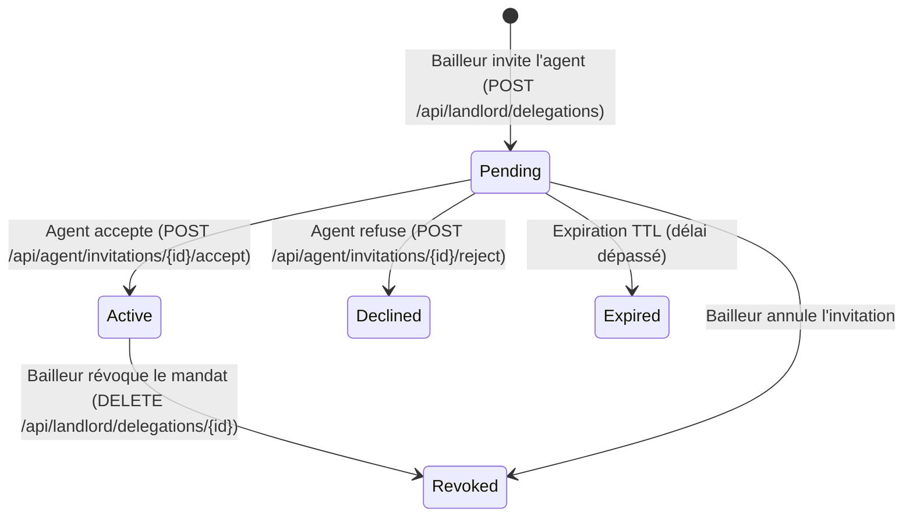

# DOCUMENTATION TECHNIQUE & API — ÉTAPE 3 : ESPACE BAILLEUR (BL) & ESPACE AGENT (AG)

## Modules BL (Bailleur), AG (Agent Immobilier), LG (KYC) & VIS / IM / SUB

Cette documentation détaille l'architecture backend, le schéma de données PostgreSQL, les contrats d'API REST, les politiques de contrôle d'accès, la matrice des permissions et la correspondance avec les écrans de l'application mobile BANGO (React Native / Expo).

---

## 1. Vue d'ensemble de l'architecture

### 1.1. Modèle conceptuel & Rôles
L'étape 3 structure deux espaces métier professionnels sécurisés par l'authentification OAuth2 Passport et le middleware `subscribed:<badge>` :
- **Espace Bailleur (`BL`)** :
  - Consultation et pilotage du portefeuille de biens (`GET /api/landlord/properties`).
  - Changement de statut unifié : `published`, `reserved`, `taken` (`PATCH /api/landlord/properties/{id}/status`).
  - Configuration et synchronisation par lot des créneaux de visite (`PUT /api/landlord/properties/{id}/slots`).
  - Traitement des demandes de visite entrantes (`GET /api/landlord/visit-requests`).
  - Dépôt de dossier KYC avec stockage privé sécurisé (`POST /api/landlord/kyc/submit`).
  - Émission et gestion des mandats de délégation vers les agents certifiés (`POST /api/landlord/delegations`, `DELETE /api/landlord/delegations/{id}`).
- **Espace Agent Immobilier (`AG`)** :
  - Consultation des invitations et mandats reçus.
  - Acceptation atomique (`POST /api/agent/invitations/{id}/accept`) ou refus motivé (`POST /api/agent/invitations/{id}/reject`).
  - Consultation du portefeuille de biens sous mandat actif (`GET /api/agent/properties`) avec exposition des capacités effectives (`visits`, `reply`, `edit`).
  - Suivi des prospects et demandes de visite sur les mandats autorisés (`GET /api/agent/prospects`).
  - Annuaire public de recherche d'agents certifiés sans divulgation de données privées (`GET /api/agents/search`).

### 1.2. Cycle de vie d'une délégation de mandat



---

## 2. Schéma de base de données (PostgreSQL)

### 2.1. Table `delegations`
Assure la liaison formelle, historique et auditable entre un bailleur, un agent et un bien immobilier.

| Colonne | Type | Contraintes & Index | Description |
| :--- | :--- | :--- | :--- |
| `id` | `uuid` | Primary Key | Identifiant unique UUIDv4 |
| `bailleur_id` | `bigint unsigned` | FK -> `users(id)`, onDelete Cascade | Propriétaire bailleur donneur d'ordre |
| `agent_id` | `bigint unsigned` | FK -> `users(id)`, onDelete Cascade | Agent immobilier invité/mandaté |
| `listing_id` | `uuid` | FK -> `listings(id)`, onDelete Cascade | Annonce de bien déléguée |
| `status` | `varchar(32)` | Index (pending, active, declined, revoked, expired) | État du mandat |
| `capabilities` | `json` / `jsonb` | Non null, default `["visits", "reply"]` | Capacités accordées (`visits`, `reply`, `edit`) |
| `invited_at` | `timestamp` | Nullable | Horodatage de l'émission de l'invitation |
| `answered_at` | `timestamp` | Nullable | Horodatage d'acceptation ou de refus |
| `expires_at` | `timestamp` | Nullable, Index | Date limite de validité de l'invitation ou du mandat |
| `revoked_at` | `timestamp` | Nullable | Horodatage de la révocation |
| `revoked_by_id` | `bigint unsigned` | FK -> `users(id)`, Nullable | Auteur de la révocation |
| `declined_reason` | `varchar(255)` | Nullable | Motif renseigné en cas de refus |
| `metadata` | `json` / `jsonb` | Nullable | Données d'audit additionnelles |

Index composites d'optimisation :
- `['bailleur_id', 'status']`
- `['agent_id', 'status']`
- `['listing_id', 'status']`

### 2.2. Tables KYC (`kyc_submissions` & `kyc_documents`)

#### Table `kyc_submissions`
Historise les dossiers soumis par les utilisateurs (bailleurs ou agents) pour certification.
- `id` : UUID PK
- `user_id` : FK `users(id)`
- `status` : `pending`, `supplement_requested`, `approved`, `rejected`
- `full_name`, `id_type`, `id_number`, `expires_on`, `property_right`, `deed_type`
- `admin_notes`, `rejection_reason`, `decided_at`, `decided_by_id`

#### Table `kyc_documents`
Référence les pièces justificatives téléversées et stockées de manière étanche.
- `id` : UUID PK
- `kyc_submission_id` : FK `kyc_submissions(id)`
- `user_id` : FK `users(id)`
- `kind` : `front`, `back`, `selfie`, `deed`, `other`
- `file_path` : chemin de stockage interne sur le disque sécurisé `local` (`app/private`)
- `original_name`, `mime_type`, `file_size`, `status`

---

## 3. Matrice des autorisations et permissions

| Action | Utilisateur standard | Bailleur propriétaire | Agent avec mandat actif (`capabilities`) | Agent sans mandat ou mandat révoqué |
| :--- | :--- | :--- | :--- | :--- |
| **Consulter le tableau de bord bailleur** | ❌ 403 `SUBSCRIPTION_REQUIRED` | ✅ Oui (ses biens propres) | ❌ 403 (espace propre au bailleur) | ❌ 403 |
| **Modifier le statut d'un bien** | ❌ 403 | ✅ Oui (`published`, `reserved`, `taken`) | ✅ Uniquement si capacité `edit` | ❌ 403 |
| **Modifier les détails d'un bien** | ❌ 403 | ✅ Oui | ✅ Uniquement si capacité `edit` | ❌ 403 |
| **Gérer les créneaux de visite (`PUT`)** | ❌ 403 | ✅ Oui | ✅ Uniquement si capacité `visits` | ❌ 403 |
| **Traiter les demandes de visite (`answer`)** | ❌ 403 | ✅ Oui | ✅ Uniquement si capacité `visits` | ❌ 403 |
| **Répondre aux messages du bien** | ❌ Selon droits prospect | ✅ Oui | ✅ Uniquement si capacité `reply` | ❌ 403 |
| **Inviter un agent (`delegations`)** | ❌ 403 | ✅ Oui (Badge Bailleur actif requis) | ❌ 403 | ❌ 403 |
| **Révoquer un mandat** | ❌ 403 | ✅ Oui (propriétaire de l'annonce) | ❌ 403 | ❌ 403 |
| **Consulter le portefeuille agent** | ❌ 403 `SUBSCRIPTION_REQUIRED` | ❌ Non | ✅ Oui (biens sous mandat actif) | ❌ 403 |
| **Consulter l'annuaire des agents** | ✅ Public | ✅ Public | ✅ Public | ✅ Public |
| **Télécharger un document KYC** | ❌ 403 | ✅ Ses propres documents uniquement | ❌ 403 (isolation totale) | ❌ 403 |

---

## 4. Documentation des Endpoints

### 4.1. `GET /api/landlord/properties`
- **Objectif** : Fournit le tableau de bord des biens du bailleur avec indicateurs agrégés.
- **Middleware** : `auth:api`, `subscribed:landlord`
- **Filtres de requête** : `status` (string), `city` (string), `mode` (string), `sort` (string), `page` (int), `per_page` (int).
- **Réponse Succès (200 OK)** :
```json
{
  "data": [
    {
      "id": "a0e0b567-1b3f-48da-937f-2bae52aa8794",
      "title": "Villa Bonapriso",
      "status": "published",
      "price": 450000.0,
      "currency": "XOF",
      "views_count": 142,
      "saves_count": 18,
      "pending_visits_count": 2,
      "confirmed_visits_count": 5,
      "active_agent": {
        "id": 14,
        "name": "Jean Agent",
        "handle": "jean_agent",
        "capabilities": ["visits", "reply"]
      },
      "created_at": "2026-10-15T08:00:00Z"
    }
  ],
  "meta": { "current_page": 1, "per_page": 15, "total": 1 }
}
```

### 4.2. `PATCH /api/landlord/properties/{id}/status`
- **Objectif** : Transition de statut d'un bien (`published`, `reserved`, `taken`).
- **Middleware** : `auth:api`
- **Effet de bord atomique** : Si le statut devient `taken`, tous les créneaux futurs ouverts sont automatiquement fermés (`closed`) sans altérer les visites déjà confirmées ou passées.
- **Corps de requête** :
```json
{
  "status": "taken",
  "reason": "Bien loué avec succès"
}
```

### 4.3. `PUT /api/landlord/properties/{id}/slots`
- **Objectif** : Synchronisation globale ou par lot des créneaux de visite selon une grille hebdomadaire récurrente ou une liste explicite.
- **Middleware** : `auth:api` (Bailleur propriétaire ou Agent avec capacité `visits`)
- **Corps de requête** :
```json
{
  "slot_duration_minutes": 30,
  "horizon_days": 14,
  "days": [
    { "day": 1, "from": "09:00", "to": "12:00" },
    { "day": 3, "from": "14:00", "to": "18:00" }
  ]
}
```

### 4.4. `GET /api/landlord/visit-requests`
- **Objectif** : Récupère les demandes de visite entrantes adressées au bailleur.
- **Middleware** : `auth:api`
- **Filtres** : `status` (`requested`, `confirmed`, `proposed`, etc.), `listing_id` (uuid).

### 4.5. `POST /api/landlord/kyc/submit`
- **Objectif** : Dépôt sécurisé des pièces justificatives d'identité et de propriété.
- **Middleware** : `auth:api` (exempté de badge préalable afin de permettre la certification).
- **Fichiers acceptés** : `identity_front`, `identity_back`, `selfie`, `property_deed`. Formats JPEG, PNG, WEBP, PDF (max 10 Mo). Stockage privé `local` (`app/private`).

### 4.6. `POST /api/landlord/delegations`
- **Objectif** : Inviter un agent certifié pour un bien spécifique.
- **Middleware** : `auth:api`, `subscribed:landlord`
- **Règles métier** :
  - L'agent doit posséder un badge Agent valide et vérifié.
  - Quota maximum de 5 mandats/agents simultanés par annonce.
  - Interdiction d'auto-invitation et de doublons d'invitation active/en attente.
  - Déclenche la notification `AgentInvitationNotification`.
- **Corps de requête** :
```json
{
  "listing_id": "a0e0b567-1b3f-48da-937f-2bae52aa8794",
  "agent_id": 42,
  "capabilities": ["visits", "reply", "edit"],
  "expires_days": 30
}
```

### 4.7. `POST /api/agent/invitations/{id}/accept` & `/reject`
- **Objectif** : Réponse de l'agent à une invitation de mandat.
- **Middleware** : `auth:api`, `subscribed:agent`
- **Règles métier** :
  - Seul l'agent destinataire peut répondre.
  - Vérification de non-expiration et statut `pending`.
  - Après acceptation : statut devient `active`, et notification `AgentAcceptedNotification` transmise au bailleur.
  - Après refus : statut devient `declined`, et notification `AgentDeclinedNotification` transmise au bailleur.

### 4.8. `DELETE /api/landlord/delegations/{id}`
- **Objectif** : Révocation immédiate d'un mandat ou annulation d'invitation.
- **Règles métier** : Révocation logique (`status = 'revoked'`, `revoked_at = now()`, `revoked_by_id = user.id`). Désactive instantanément les capacités de l'agent tout en préservant l'intégrité de l'historique et des visites antérieures.

### 4.9. `GET /api/agent/properties`
- **Objectif** : Portefeuille des biens sous mandat actif et non expiré de l'agent.
- **Middleware** : `auth:api`, `subscribed:agent`
- **Champs exposés** : Informations du bien, coordonnées du bailleur, et `effective_capabilities`.

### 4.10. `GET /api/agent/prospects`
- **Objectif** : Contacts et demandes de visite associés aux mandats actifs de l'agent.
- **Protection** : Isolation stricte inter-comptes, accès restreint aux seuls biens sous mandat actif.

### 4.11. `GET /api/agents/search`
- **Objectif** : Annuaire public des agents certifiés BANGO.
- **Middleware** : Public (aucun token requis).
- **Filtres** : `city` (string), `search` (string), `page` (int), `per_page` (int).
- **Sécurité** : Filtre les utilisateurs non vérifiés ou sans badge Agent. Ne divulgue jamais les emails, mots de passe, documents KYC ou informations financières.

---

## 5. Correspondance Frontend / Backend

| Écran Mobile Frontend | Service TypeScript Frontend | Endpoint Backend | Contrôleur Backend | Form Request / Resource |
| :--- | :--- | :--- | :--- | :--- |
| Tableau de bord Bailleur | `lib/api/landlord.ts` -> `getProperties()` | `GET /api/landlord/properties` | `LandlordPropertyController@index` | `LandlordPropertyResource` |
| Fiche Bien (Changement statut) | `lib/api/landlord.ts` -> `updateStatus()` | `PATCH /api/landlord/properties/{id}/status` | `LandlordPropertyController@updateStatus` | `UpdateLandlordListingStatusRequest` |
| Agenda & Créneaux Bailleur | `lib/api/landlord.ts` -> `updateSlots()` | `PUT /api/landlord/properties/{id}/slots` | `LandlordPropertyController@updateSlots` | `UpdatePropertySlotsRequest` |
| Demandes de visite entrantes | `lib/api/landlord.ts` -> `getVisitRequests()` | `GET /api/landlord/visit-requests` | `LandlordPropertyController@visitRequests` | `VisitReservationResource` |
| Dépôt KYC Bailleur / Agent | `lib/api/kyc.ts` -> `submitKyc()` | `POST /api/landlord/kyc/submit` | `LandlordKycController@submit` | `SubmitKycRequest` / `KycSubmissionResource` |
| Invitation d'un agent | `lib/api/agents.ts` -> `inviteAgent()` | `POST /api/landlord/delegations` | `LandlordDelegationController@store` | `InviteAgentRequest` / `DelegationResource` |
| Révocation d'un mandat | `lib/api/agents.ts` -> `revokeDelegation()` | `DELETE /api/landlord/delegations/{id}` | `LandlordDelegationController@destroy` | `DelegationResource` |
| Invitations Agent (Accepter) | `lib/api/agents.ts` -> `acceptInvitation()` | `POST /api/agent/invitations/{id}/accept` | `AgentInvitationController@accept` | `DelegationResource` |
| Invitations Agent (Refuser) | `lib/api/agents.ts` -> `rejectInvitation()` | `POST /api/agent/invitations/{id}/reject` | `AgentInvitationController@reject` | `DelegationResource` |
| Portefeuille Agent | `lib/api/agents.ts` -> `getPortfolio()` | `GET /api/agent/properties` | `AgentPortfolioController@index` | `AgentPropertyResource` |
| Prospects Agent | `lib/api/agents.ts` -> `getProspects()` | `GET /api/agent/prospects` | `AgentPortfolioController@prospects` | `AgentProspectResource` |
| Annuaire Public des Agents | `lib/api/agents.ts` -> `searchAgents()` | `GET /api/agents/search` | `AgentDirectoryController@search` | `SearchAgentsRequest` / `AgentDirectoryResource` |

---

## 6. Guide d'exécution et de validation

### Exécution des tests Pest ciblés Étape 3 (BL & AG)
```bash
php artisan test --compact tests/Feature/Landlord tests/Feature/Agent
```

### Exécution de la suite complète de non-régression
```bash
php artisan test --compact
```

### Formatage du code (Laravel Pint)
```bash
vendor/bin/pint --format agent
```
