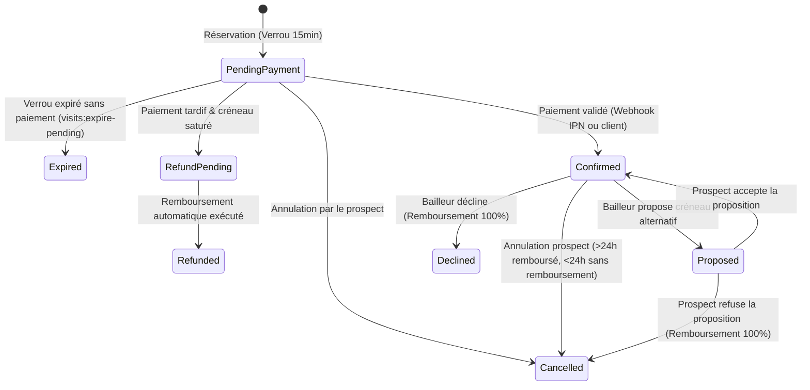

# DOCUMENTATION TECHNIQUE & API — ÉTAPE 2 : VISITES IMMOBILIÈRES

## Module IM (Immobilier) & BL / AG / PAY / EDGE / SY

Cette documentation détaille l'architecture backend, le modèle de données, les contrats d'API, les mécanismes de verrouillage transactionnel, les flux de paiement et les contrôles de sécurité développés pour l'**Étape 2 : Agenda, créneaux et réservation transactionnelle des visites immobilières** dans l'écosystème BANGO.

---

## 1. Vue d'ensemble de l'architecture

### 1.1. Modèle conceptuel

Le cycle de réservation des visites immobilières articule plusieurs acteurs :
- **Prospect (Utilisateur mobile)** : consulte la grille des disponibilités, réserve avec un verrou de 15 minutes, règle les frais de visite (`visit_fee`), reçoit la confirmation et l'adresse privée.
- **Bailleur (Propriétaire de l'annonce)** : administre ses disponibilités (création de créneaux personnalisés, fermeture), reçoit les demandes, peut accepter, décliner ou proposer une alternative d'horaire.
- **Agent immobilier mandaté** : intervient pour le compte du bailleur sur les annonces qui lui sont déléguées avec le droit de gestion des visites.
- **Moteur PAY (Mobile Money Monetbil)** : assure l'encaissement via les flux transactionnels sans aucune interférence avec les abonnements (AB).
- **Planificateur EDGE** : libère automatiquement les verrous de 15 minutes non réglés et gère l'arbitrage automatique des demandes sans réponse après 18h.



---

## 2. Distinction stricte PAY vs AB

* **Domaine PAY (Frais de visite)** :
  - Prestation ponctuelle rattachée par relation polymorphe `payable_type = App\Models\Visit\VisitReservation` et `payable_id = reservation.id`.
  - Type de service : `PaymentServiceType::Visit` (`'visit'`).
  - Aucun enregistrement n'est inséré dans les tables `subscriptions` ou `badge_histories`.
  - En cas d'annulation éligible ou de refus, le remboursement s'effectue via `PaymentEngineService::refundTransaction()` avec journalisation de l'événement `refund_processed`.
* **Domaine AB (Abonnements & Badges)** :
  - Conserve son cycle de vie autonome (`SubscriptionLifecycleService`, périodes de grâce, renouvellements).
  - Aucune dépendance croisée : le règlement d'une visite n'octroie ni ne prolonge un badge.

---

## 3. Sécurité & Protection de la vie privée

### 3.1. Révélation conditionnelle de l'adresse (`address`)
Pour protéger la tranquillité des propriétaires et prévenir les contournements de visites :
- L'adresse exacte (`address`) d'une annonce reste **strictement masquée (`null`)** dans `GET /api/listings/{id}` tant que l'utilisateur n'est pas :
  1. Le propriétaire de l'annonce (`owner_id === user.id`).
  2. L'agent mandaté pour ce bien (`agent_id === user.id`).
  3. Un administrateur de la plateforme (`user.isAdmin() === true`).
  4. Un prospect ayant une réservation **officiellement confirmée** (`hasConfirmedVisitBy(user)`).
- Avant la confirmation du paiement, les endpoints `/api/visits/{id}` et `/api/visits/{id}/receipt` retournent `address: null` et `can_view_address: false`.

---

## 4. Endpoints API

### 4.1. Consultation des créneaux disponibles
**`GET /api/listings/{id}/slots`**
- **Accès** : Public (ou authentifié).
- **Rôle** : Calcule la grille des créneaux sur 5 jours ouvrés à compter de J+0, avec déduction de la durée minimum (4h) et des réservations concurrentes actives.
- **Réponse JSON (200 OK)** :
```json
{
  "data": [
    {
      "id": "2026-10-18",
      "date": "2026-10-18",
      "weekday": "DIM",
      "day": "18",
      "available": true,
      "slots": [
        {
          "id": "01a14161-071d-72fa-98bc-cba5d24e7d65",
          "time": "10:00",
          "start_at": "2026-10-18T10:00:00+01:00",
          "end_at": "2026-10-18T10:30:00+01:00",
          "capacity": 1,
          "booked_count": 0,
          "available": true,
          "is_mine": false
        }
      ]
    }
  ]
}
```

---

### 4.2. Poser une réservation avec verrou de 15 minutes
**`POST /api/listings/{id}/visits`**
- **Accès** : Authentifié (`auth:api`).
- **Corps de requête** :
```json
{
  "slot_id": "01a14161-071d-72fa-98bc-cba5d24e7d65",
  "message": "Bonjour, je souhaite visiter ce duplex samedi.",
  "channel": "mobile_money",
  "operator": "orange",
  "phone_number": "+237699112233",
  "idempotency_key": "BOOK-VISIT-UUID-001"
}
```
- **Comportement backend** :
  1. Transaction SQL avec verrou pessimiste `lockForUpdate()` sur le créneau.
  2. Vérification d'absence de collision : `activeHolds < capacity`.
  3. Verrou temporaire de 15 minutes (`lock_expires_at = now() + 15min`).
  4. Initialisation d'une transaction PAY Monetbil rattachée.
- **Réponse JSON (201 Created)** :
```json
{
  "message": "Réservation initiée avec succès. Veuillez finaliser le règlement dans les 15 minutes.",
  "data": {
    "id": "01a14162-88af-7411-b1e2-9f33b1cb8721",
    "listing_id": "01a140f0-82a1-7132-8419-fa589947aa10",
    "status": "pending_payment",
    "status_label": "Paiement en attente",
    "lock_expires_at": "2026-10-15T22:25:00+01:00",
    "is_lock_active": true,
    "fee_amount": 5000,
    "currency": "XAF",
    "can_view_address": false
  },
  "transaction": {
    "id": 42,
    "reference": "BNG-TX-20261015-8K4L1A9Z",
    "status": "pending",
    "amount": 5000,
    "currency": "XAF"
  },
  "quote": {
    "fee_amount": 5000,
    "currency": "XAF",
    "total_amount": 5000,
    "cancellation_policy": "Remboursement intégral en cas d'annulation plus de 24h avant la visite ou refus du bailleur."
  }
}
```

---

### 4.3. Confirmation post-paiement côté client
**`POST /api/visits/{id}/confirm`**
- **Accès** : Authentifié (`auth:api`, titulaire uniquement).
- **Rôle** : Synchronise l'état serveur. Si le webhook IPN a déjà confirmé, valide immédiatement la visite. Si la transaction est en cours, interroge la passerelle Monetbil via `checkStatus()`. Aucune confirmation sur simple déclaration client.
- **Réponse JSON (200 OK)** :
```json
{
  "message": "Visite confirmée avec succès. L'adresse exacte vous a été transmise.",
  "data": {
    "id": "01a14162-88af-7411-b1e2-9f33b1cb8721",
    "status": "confirmed",
    "status_label": "Confirmée",
    "paid_at": "2026-10-15T22:12:00+01:00",
    "can_view_address": true,
    "listing": {
      "address": "142 Rue des Palmiers, Bonapriso, Douala"
    }
  }
}
```

---

### 4.4. Historique personnel du prospect
**`GET /api/visits/mine?status=confirmed&per_page=15`**
- **Accès** : Authentifié (`auth:api`).
- **Rôle** : Isole strictement les réservations du prospect connecté.

---

### 4.5. Annulation d'une visite
**`POST /api/visits/{id}/cancel`**
- **Accès** : Authentifié (`auth:api`, prospect, bailleur, agent mandaté ou admin).
- **Règle financière IM-14** :
  - Annulation > 24h avant l'heure de visite : remboursement intégral (`status: refunded`, `refund_channel: bango_credit`).
  - Annulation < 24h avant par le prospect : frais conservés (`status: cancelled`, `refund_amount: null`).
  - Annulation par le bailleur/agent : remboursement intégral systématique.

---

### 4.6. Gestion des propositions alternatives
- **Bailleur propose** : `POST /api/landlord/visits/{id}/answer` avec `action: "propose"` et `proposal_slot_id: "UUID"`.
- **Prospect répond** : `POST /api/visits/{id}/proposal/respond` avec `accept: true` (confirme le nouveau créneau) ou `accept: false` (annule et rembourse intégralement).

---

### 4.7. Reçu officiel de visite
**`GET /api/visits/{id}/receipt`**
- **Accès** : Authentifié (prospect ou administrateur).
- **Contenu** : Référence de transaction, nom du payeur, adresse du bien (si confirmée), montant acquitté, canal de paiement et date d'émission.

---

### 4.8. Espace Bailleur / Agent (BL-04 / AG-02 / AG-03)
- `GET /api/landlord/properties/{id}/slots` : Consultation de tous les créneaux.
- `POST /api/landlord/properties/{id}/slots` : Création d'un créneau (`start_at`, `end_at`, `capacity`).
- `DELETE /api/landlord/properties/{id}/slots/{slotId}` : Fermeture d'un créneau (interdite si des visites confirmées existent).
- `GET /api/landlord/properties/{id}/visit-requests` : Liste paginée des demandes de visite.
- `POST /api/landlord/visits/{id}/answer` : Traitement d'une visite (`accept`, `propose`, `decline`).

---

## 5. Commandes de planificateur (EDGE)

| Commande Artisan | Fréquence cron | Description |
|---|---|---|
| `visits:expire-pending` | `* * * * *` (chaque minute) | Détecte les verrous de 15 minutes expirés sur les réservations non payées, passe le statut à `expired` et libère la capacité. |
| `visits:settle-overdue` | `0 * * * *` (chaque heure) | Détecte les demandes en attente de réponse bailleur depuis plus de 18h, décline avec le motif `no-answer` et recrédite le prospect. |

---

## 6. Notifications SY

Les notifications suivantes utilisent le canal `database` de Laravel (sans bloquer les transactions SQL) :
- `VisitRequestedNotification` : adressée au bailleur et à l'agent mandaté.
- `VisitConfirmedNotification` : adressée au prospect, au bailleur et à l'agent.
- `VisitCancelledNotification` : adressée aux parties lors de l'annulation.
- `VisitDeclinedNotification` : adressée au prospect lors d'un refus ou d'une expiration 18h.
- `VisitProposedNotification` : adressée au prospect avec les détails du créneau alternatif.
