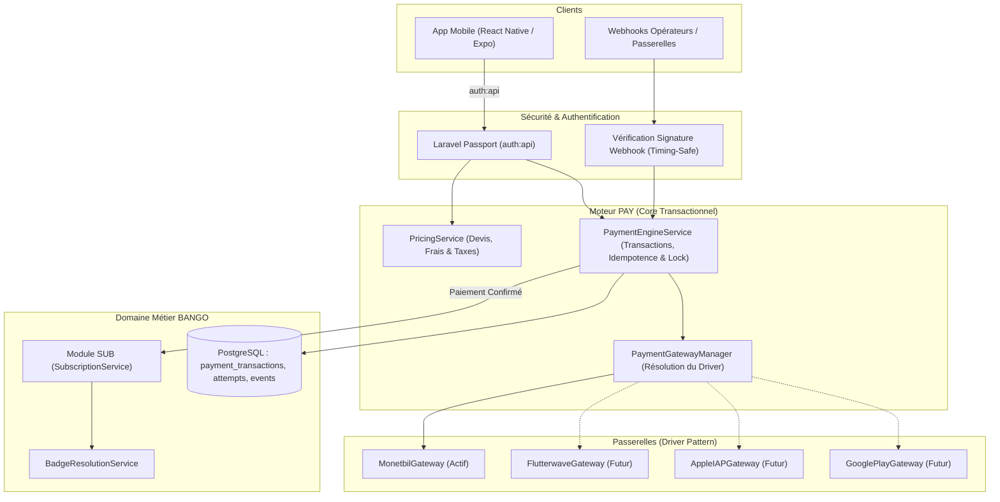
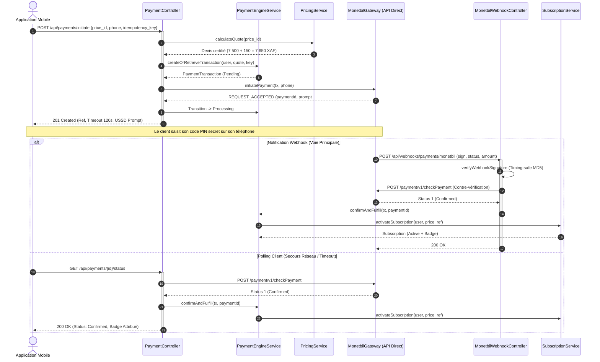

# BANGO — Architecture Technique du Module PAY

Ce document détaille l'architecture logicielle, les contrats d'interface, la gestion des passerelles et les invariants transactionnels du module **PAY**.

---

## 1. Principes Directeurs d'Architecture

1. **Découplage Strict :**
   - Le moteur transactionnel (`PaymentEngineService`) et le moteur de tarification (`PricingService`) sont totalement agnostiques de la passerelle de paiement.
   - La logique financière ne dépend d'aucun SDK externe.
2. **Driver Pattern / Gestionnaire de Passerelles :**
   - L'accès aux passerelles repose sur `PaymentGatewayInterface` et `PaymentGatewayManager`.
   - Un seul agrégateur Mobile Money est actif à la fois (Monetbil au lancement), sélectionné via la variable d'environnement `PAYMENT_ACTIVE_GATEWAY`.
   - Remplacement ultérieur par Flutterwave possible par simple configuration, sans altération des transactions passées.
3. **Rails Distincts pour Stores (Apple IAP & Google Play) :**
   - Les achats intégrés sur l'App Store et Google Play sont traités comme des canaux techniques distincts (`apple_iap`, `google_play`).
   - Leurs commissions sont directement prélevées par les stores et leur validation reposera sur la vérification des reçus cryptographiques.
4. **Intégrité & Non-Régression :**
   - Authentification basée exclusivement sur **Laravel Passport** (`auth:api`).
   - Préservation intégrale des règles du module **SUB** : `SubscriptionService::activateSubscription()` est le seul point d'entrée autorisé pour activer un abonnement.

---

## 2. Diagramme des Composants



---

## 3. Contrat de Passerelle (`PaymentGatewayInterface`)

Chaque passerelle implémente le contrat suivant :

```php
namespace App\Services\Payment\Contracts;

use App\Models\Payment\PaymentTransaction;
use App\Services\Payment\DTO\GatewayInitiateResult;
use App\Services\Payment\DTO\GatewayStatusResult;

interface PaymentGatewayInterface
{
    public function getIdentifier(): string;

    public function isAvailable(): bool;

    public function initiatePayment(PaymentTransaction $transaction, array $params = []): GatewayInitiateResult;

    public function checkStatus(PaymentTransaction $transaction): GatewayStatusResult;
}
```

### Réponses Normalisées (DTOs) :
- **`GatewayInitiateResult` :** renvoie le statut de prise en compte (`isSuccessful`), l'identifiant passerelle (`gatewayReference`), le code opérateur (`operatorCode`), l'invite USSD (`ussdPrompt`, ex: `#150*50#`), et le délai d'expiration (`timeoutSeconds = 120`).
- **`GatewayStatusResult` :** renvoie le statut normalisé (`PaymentStatus::Confirmed`, `Processing`, `Failed`), avec les références télécom et les codes d'erreur expurgés.

---

## 4. Gestionnaire de Passerelles (`PaymentGatewayManager`)

Le gestionnaire résout le driver actif configuré sans jamais tolérer de basculement silencieux vers un autre fournisseur :

```php
$manager = app(PaymentGatewayManager::class);

// Résolution du driver actif par défaut (ex: Monetbil)
$gateway = $manager->driver();

// Résolution explicite
$monetbil = $manager->driver('monetbil');
```

- **Règle de sécurité :** Si une passerelle demandée est inconnue ou désactivée dans `config/payment.php`, une exception `UnsupportedGatewayException` est levée immédiatement.

---

## 5. Raccordement Sécurisé avec le Module SUB

Le moteur transactionnel PAY ne modifie jamais directement la table `subscriptions` ni la colonne `users.badge`.

Dès qu'une transaction est confirmée :
1. `PaymentEngineService::confirmAndFulfill()` applique un verrou pessimiste `lockForUpdate()` sur la transaction.
2. Si la transaction est déjà marquée `confirmed` ou a déjà été honorée (`subscription_id !== null`), l'opération est arrêtée immédiatement (idempotence absolue contre les doubles notifications).
3. Le statut transite vers `confirmed` via `transitionTo()`.
4. Pour un abonnement (`service_type === PaymentServiceType::Subscription`), l'appel métier suivant est exécuté :
   ```php
   $subscription = $this->subscriptionService->activateSubscription(
       user: $lockedTx->user,
       price: $lockedTx->price,
       paymentReference: $lockedTx->reference,
       metadata: [
           'payment_transaction_id' => $lockedTx->id,
           'provider' => $lockedTx->provider->value,
           'amount_paid' => (float) $lockedTx->total_amount,
           'currency' => $lockedTx->currency,
       ]
   );
   ```
5. L'identifiant `$subscription->id` est consigné dans `payment_transactions.subscription_id` et un événement immuable `subscription_fulfilled` est journalisé dans `payment_events`.

---

## 6. Flux Séquentiel Réel d'un Paiement Mobile (Phase 3)


