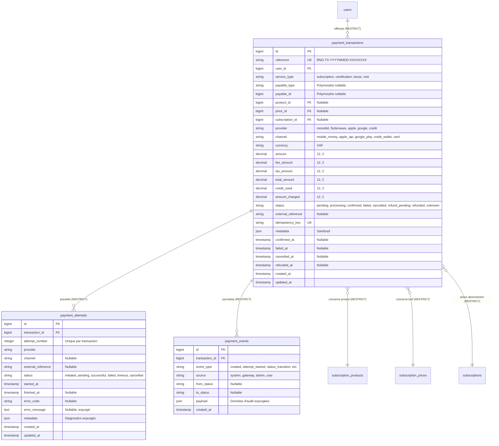

# BANGO — Spécification & Dictionnaire de Données du Module PAY (Phase 1)

Ce document formalise le socle de données transactionnelles du module **PAY**, mis en œuvre conformément à l'audit préalable `docs/PAY_AUDIT.md`.

---

## 1. Vue d'Ensemble & Principes d'Intégrité

1. **Source de Vérité Financière Unique :**
   - Aucune transaction n'est considérée comme payée par un simple flag booléen (`is_paid`).
   - Le statut contrôlé de la transaction (`status`) et son journal d'événements (`payment_events`) constituent l'unique preuve d'audit.
2. **Immuabilité & Append-Only :**
   - Les événements (`payment_events`) sont strictement immuables : interdiction totale de modification ou suppression applicative.
   - Les montants des transactions sont figés lors de leur création (`amount`, `fee_amount`, `tax_amount`, `total_amount`) et ne changent jamais même en cas de mise à jour future du catalogue.
3. **Protection Contre la Perte de Données Financières :**
   - Règle de suppression `ON DELETE RESTRICT` sur la relation avec `users` : un utilisateur ayant un historique financier ne peut pas être supprimé en cascade de la base de données.
   - Règle de suppression `ON DELETE RESTRICT` sur les relations entre `payment_transactions`, `payment_attempts` et `payment_events`.
4. **Idempotence Stricte :**
   - La colonne `idempotency_key` (VARCHAR 128 UNIQUE) garantit qu'aucune requête cliente ne peut être exécutée deux fois.

---

## 2. Schéma Relationnel des Tables



---

## 3. Dictionnaire des Champs

### 3.1. Table `payment_transactions`

| Champ | Type PostgreSQL | Nullable | Contraintes / Valeurs | Rôle & Description |
| :--- | :--- | :--- | :--- | :--- |
| `id` | `BIGSERIAL` | Non | Clé primaire | Identifiant technique interne auto-incrémenté. |
| `reference` | `VARCHAR(64)` | Non | Unique, Index | Référence publique non prédictible (ex: `BNG-TX-20261014-9K3L8A7Z`). |
| `user_id` | `BIGINT` | Non | FK `users(id)` ON DELETE RESTRICT | Propriétaire de la transaction. Protégé contre toute suppression accidentelle. |
| `service_type` | `VARCHAR(32)` | Non | Cast `PaymentServiceType` | Type de prestation (`subscription`, `certification`, `boost`, `visit`). |
| `payable_type` | `VARCHAR(255)` | Oui | Index polymorphe | Type de l'entité liée (pour de futurs modules hors SUB). |
| `payable_id` | `BIGINT` | Oui | Index polymorphe | Identifiant de l'entité liée. |
| `product_id` | `BIGINT` | Oui | FK `subscription_products(id)` ON DELETE RESTRICT | Lien optionnel direct avec le produit du catalogue SUB. |
| `price_id` | `BIGINT` | Oui | FK `subscription_prices(id)` ON DELETE RESTRICT | Lien direct avec la grille tarifaire souscrite. |
| `subscription_id` | `BIGINT` | Oui | FK `subscriptions(id)` ON DELETE RESTRICT | Lien vers l'abonnement généré/renouvelé après confirmation. |
| `provider` | `VARCHAR(32)` | Non | Cast `PaymentProvider` | Passerelle de paiement (`monetbil`, `flutterwave`, `apple`, `google`, `credit`). |
| `channel` | `VARCHAR(32)` | Non | Cast `PaymentChannel` | Canal technique (`mobile_money`, `apple_iap`, `google_play`, `credit_wallet`, `card`). |
| `currency` | `VARCHAR(4)` | Non | Défaut `'XAF'` | Devise ISO 4217 de la transaction. |
| `amount` | `DECIMAL(12, 2)` | Non |  | Montant net de la prestation ou du produit catalogue. |
| `fee_amount` | `DECIMAL(12, 2)` | Non | Défaut `0.00` | Frais de passerelle / opérateur appliqués le cas échéant. |
| `tax_amount` | `DECIMAL(12, 2)` | Non | Défaut `0.00` | Montant des taxes applicables (TVA, etc.). |
| `total_amount` | `DECIMAL(12, 2)` | Non |  | Montant total dû (`amount + fee_amount + tax_amount`). |
| `credit_used` | `DECIMAL(12, 2)` | Non | Défaut `0.00` | Montant prélevé sur le solde d'avoir / Crédit BANGO. |
| `amount_charged` | `DECIMAL(12, 2)` | Non |  | Montant effectivement facturé au canal externe (`total_amount - credit_used`). |
| `status` | `VARCHAR(32)` | Non | Cast `PaymentStatus`, Défaut `'pending'` | Statut contrôlé du cycle de vie financier. |
| `external_reference`| `VARCHAR(128)` | Oui | Index avec `provider` | Identifiant externe de la passerelle (ex: `paymentId` Monetbil, `transactionId` Apple). |
| `idempotency_key` | `VARCHAR(128)` | Non | Unique | Clé d'idempotence fournie par le client ou générée à l'initialisation. |
| `metadata` | `JSON` | Oui |  | Métadonnées d'audit (terminal, OS, version de l'app mobile, contexte). |
| `confirmed_at` | `TIMESTAMP` | Oui |  | Date et heure de validation irréfutable du paiement. |
| `failed_at` | `TIMESTAMP` | Oui |  | Date et heure de survenue de l'échec. |
| `cancelled_at` | `TIMESTAMP` | Oui |  | Date et heure de l'annulation manuelle ou timeout. |
| `refunded_at` | `TIMESTAMP` | Oui |  | Date et heure de l'exécution du remboursement. |
| `created_at` | `TIMESTAMP` | Non | Index | Date de création. |
| `updated_at` | `TIMESTAMP` | Non |  | Date de dernière modification. |

### 3.2. Table `payment_attempts`

| Champ | Type PostgreSQL | Nullable | Contraintes / Valeurs | Rôle & Description |
| :--- | :--- | :--- | :--- | :--- |
| `id` | `BIGSERIAL` | Non | Clé primaire | Identifiant technique. |
| `transaction_id` | `BIGINT` | Non | FK `payment_transactions(id)` ON DELETE RESTRICT | Transaction parente. |
| `attempt_number` | `INTEGER` | Non | Unique avec `transaction_id` | Numéro d'ordre (1, 2, 3...) de la tentative. |
| `provider` | `VARCHAR(32)` | Non | Cast `PaymentProvider` | Passerelle interrogée pour cette tentative. |
| `channel` | `VARCHAR(32)` | Oui | Cast `PaymentChannel` | Canal technique utilisé. |
| `external_reference`| `VARCHAR(128)` | Oui | Index avec `provider` | Référence de session ou d'appel auprès du fournisseur. |
| `status` | `VARCHAR(32)` | Non | Cast `PaymentAttemptStatus`, Défaut `'initiated'` | Statut de la tentative (`initiated`, `pending`, `successful`, `failed`, `timeout`, `cancelled`). |
| `started_at` | `TIMESTAMP` | Non | `CURRENT_TIMESTAMP` | Début de la tentative (émission de la requête USSD/API). |
| `finished_at` | `TIMESTAMP` | Oui |  | Fin de la tentative (réception callback ou expiration 120s). |
| `error_code` | `VARCHAR(64)` | Oui |  | Code normalisé (`INSUFFICIENT_FUNDS`, `TIMEOUT`, `CANCELLED_BY_USER`, etc.). |
| `error_message` | `TEXT` | Oui |  | Message explicatif expurgé de toute donnée sensible. |
| `metadata` | `JSON` | Oui |  | Données d'audit réseau et diagnostic (latence, code HTTP, etc.). |

### 3.3. Table `payment_events`

| Champ | Type PostgreSQL | Nullable | Contraintes / Valeurs | Rôle & Description |
| :--- | :--- | :--- | :--- | :--- |
| `id` | `BIGSERIAL` | Non | Clé primaire | Identifiant technique. |
| `transaction_id` | `BIGINT` | Non | FK `payment_transactions(id)` ON DELETE RESTRICT | Transaction concernée. |
| `event_type` | `VARCHAR(64)` | Non | Index avec `created_at` | Type d'événement (`created`, `attempt_started`, `status_transition`, etc.). |
| `source` | `VARCHAR(32)` | Non | Cast `PaymentEventSource` | Acteur/origine (`system`, `gateway`, `admin`, `user`). |
| `from_status` | `VARCHAR(32)` | Oui | Cast `PaymentStatus` | Statut avant la transition (si applicable). |
| `to_status` | `VARCHAR(32)` | Oui | Cast `PaymentStatus` | Statut après la transition. |
| `payload` | `JSON` | Oui |  | Données d'audit minimales (motif, paramètres expurgés). |
| `created_at` | `TIMESTAMP` | Non | `CURRENT_TIMESTAMP`, Index | Date d'enregistrement immuable (aucune mise à jour ultérieure). |

---

## 4. Règles de Précision Monétaire & Formules

1. **Format de Stockage :**
   - Toutes les colonnes monétaires utilisent `DECIMAL(12, 2)` (ou `NUMERIC(12, 2)` sous PostgreSQL).
   - Les types à virgule flottante (`FLOAT`, `DOUBLE`) sont strictement proscrits afin d'éviter les erreurs d'arrondi binaire (norme IEEE 754).
2. **Formule du Montant Total :**
   $$\text{total\_amount} = \text{amount} + \text{fee\_amount} + \text{tax\_amount}$$
3. **Formule du Débit Passerelle (en cas d'utilisation d'avoirs BANGO) :**
   $$\text{amount\_charged} = \max(0, \text{total\_amount} - \text{credit\_used})$$
4. **Devise par Défaut :**
   - La devise opérationnelle de base est le Franc CFA d'Afrique Centrale (`XAF`).
   - Même si le XAF n'utilise traditionnellement pas de centimes en circulation physique, l'échelle à deux décimales (`.00`) respecte la norme ISO 4217, garantit l'alignement avec les grilles tarifaires de SUB (`SubscriptionPrice::price_amount` est en `12, 2`), et permet la conversion future vers les devises des stores internationaux (EUR, USD).

---

## 5. Machine à États & Transitions Autorisées

```
             ┌─────────────┐
             │   Pending   │
             └──────┬──────┘
         ┌──────────┼──────────┬──────────┐
         ▼          ▼          ▼          ▼
   ┌──────────┐┌─────────┐┌──────────┐┌─────────┐
   │Processing││Confirmed││  Failed  ││Cancelled│
   └─────┬────┘└────┬────┘└──────────┘└─────────┘
         │          │ (Terminal)       (Terminal)
   ┌─────┴────┐     │
   ▼          ▼     ▼
┌────────┐┌───────┐┌─────────────┐
│Confirmed Failed ││RefundPending│
└────────┘└───────┘└──────┬──────┘
                          ▼
                     ┌─────────┐
                     │Refunded │
                     └─────────┘
                      (Terminal)
```

- **Transitions valides :**
  - `pending` $\rightarrow$ `processing`, `confirmed`, `failed`, `cancelled`, `unknown`.
  - `processing` $\rightarrow$ `confirmed`, `failed`, `cancelled`, `unknown`.
  - `unknown` $\rightarrow$ `processing`, `confirmed`, `failed`, `cancelled`.
  - `confirmed` $\rightarrow$ `refund_pending`, `refunded`.
  - `refund_pending` $\rightarrow$ `refunded`, `confirmed` (en cas de rejet de la demande de remboursement).
- **Statuts terminaux stricts :**
  - `failed`, `cancelled`, `refunded` ne peuvent plus transiter vers aucun autre état.
  - Toute tentative de transition non autorisée lève immédiatement une exception `InvalidPaymentTransitionException`.
  - Chaque transition met à jour automatiquement son horodatage dédié (`confirmed_at`, `failed_at`, `cancelled_at`, `refunded_at`) et insère un enregistrement dans `payment_events`.

---

## 6. Vérification & Résultats des Tests

La suite de tests a été exécutée sur l'environnement de développement sous PostgreSQL et Pest.

### Commandes Exécutées

```bash
# Exécution des tests du module PAY
php artisan test --compact tests/Feature/Payment

# Exécution de la suite complète de non-régression
php artisan test --compact

# Formatage du code avec Laravel Pint
vendor/bin/pint --format agent
```

### Résultats Obtenus

- **Tests Module PAY :** `14 passed, 63 assertions` (durée : 1.34s).
- **Suite Complète du Projet :** `124 passed, 604 assertions, 0 failed` (durée : 7.77s).
- **Formatage Pint :** 100% conforme aux règles Laravel Boost.

---

## 7. Éléments Restant à Développer dans la Phase 2

1. **Driver Passerelle Monetbil :**
   - Implémentation du driver `MonetbilGateway` avec client HTTP resilient.
   - Initialisation du paiement push USSD (`v1/placePayment`).
   - Endpoint de vérification asynchrone direct (`v1/checkPayment`).
2. **Contrôleur de Webhooks Sécurisé :**
   - Route publique protégée `POST /api/webhooks/payments/monetbil`.
   - Contrôle timing-safe de la signature MD5 avec `SERVICE_SECRET`.
   - Job de traitement asynchrone sécurisé déclenchant `SubscriptionService::activateSubscription()`.
3. **Contrôleurs API Mobile :**
   - `POST /api/payments/initiate` (génération de clé d'idempotence, initialisation transaction et première tentative).
   - `GET /api/payments/{id}/status` (polling sécurisé avec appel de contrôle Monetbil).
   - `POST /api/payments/{id}/cancel` (annulation client).
   - `GET /api/payments/history` (historique paginé).
