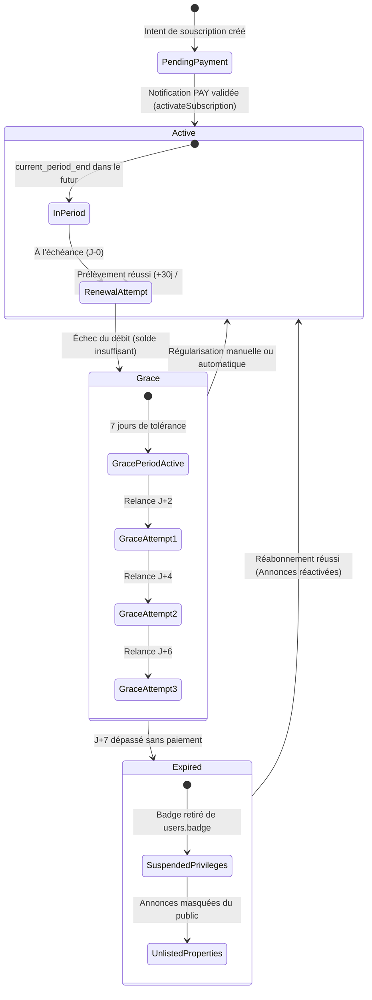

# BANGO — Règles Métier, Badges & Droits d'Accès (Module SUB)

Ce document formalise les règles métier régissant le cycle de vie des abonnements, les conditions d'attribution des badges de confiance et les politiques d'autorisation.

---

## 1. Typologie des Badges et Anneaux de Profil

Conformément à la charte visuelle BANGO et aux modules frontend `lib/badges.ts` et `theme/colors.ts` :

| Badge Identifiant | Rôle Métier | Couleur Anneau Avatar | Code Hexadécimal | Conditions d'Attribution Cumulatives |
| :--- | :--- | :--- | :--- | :--- |
| **`none`** | Utilisateur Simple | *Aucun anneau* | `null` | Utilisateur sans abonnement pro actif ou sans KYC approuvé. |
| **`landlord`** | Bailleur Certifié | **Vert Bailleur** | `#1E9E5A` | Abonnement Bailleur actif/en grâce **ET** KYC approuvé (`is_verified = true`) **ET** documents valides (`verification_lapsed = false`). |
| **`agent`** | Agent Immobilier | **Orange Agent** | `#E69900` | Abonnement Agent actif/en grâce **ET** KYC approuvé **ET** documents valides. |
| **`double`** | Bailleur & Agent | **Rouge Signature** | `#D80F0F` | L'utilisateur détient **simultanément** un abonnement Bailleur ET un abonnement Agent valides avec KYC approuvé. *Règle UI : un anneau rouge unifié unique remplace les deux anneaux.* |
| **`page`** | Page Pro Certifiée | **Rouge + Bouclier** | `#D80F0F` | Page d'entreprise certifiée après audit du dossier RCCM et identité du gérant. |

---

## 2. Distinction Stricte entre Paiement et KYC

L'argent ne donne pas le droit d'ignorer la loi et la sécurité des utilisateurs.

$$\text{Badge Affiché} = (\text{Abonnement Payé et Actif}) \land (\text{KYC Approuvé}) \land (\text{Non Échu})$$

1. **Cas d'un utilisateur ayant payé sans KYC :**
   - L'abonnement est `state = active`.
   - Le statut de badge reste `badge = none`.
   - L'anneau de profil n'est pas affiché.
   - La publication d'annonces reste verrouillée par le middleware `EnsureActiveSubscription:landlord`.
2. **Cas de l'expiration d'une pièce d'identité (`verification_lapsed = true`) :**
   - Même si l'abonnement financier est payé jusqu'à la fin de l'année, le badge est temporairement désactivé.
   - Les actions de publication renvoient une erreur HTTP `403 Forbidden` avec `code: 'KYC_LAPSED'`.
   - Dès téléversement et approbation d'une nouvelle pièce d'identité valide, le badge est instantanément restauré.

---

## 3. Cycle de Vie d'un Abonnement et Période de Grâce (7 Jours)

### Règles de la Période de Grâce :
1. **Maintien intégral des privilèges :**
   - Pendant les 7 jours de grâce (`state = grace`), le badge **reste visible** sur le profil et les annonces **restent en ligne**.
   - Ceci protège les bailleurs et agents contre les désagréments liés aux pannes de réseau Mobile Money ou aux délais de recharge.
2. **Expiration définitive :**
   - Dès le 8e jour sans régularisation, le statut bascule à `expired`.
   - Le badge est révoqué (`badge = none`).
   - Les annonces passent au statut masqué (`is_unlisted = true`), mais **aucune donnée ni photo n'est supprimée**.
   - Dès que l'utilisateur souscrit à nouveau, ses annonces sont immédiatement réactivées sans ressaisie.

---

## 4. Politique de Résiliation (Churn)

1. **Prise d'effet à terme :**
   - La résiliation demandée par un utilisateur (`POST /api/subscriptions/{id}/cancel`) ne coupe pas immédiatement le service.
   - `auto_renew` passe à `false`.
   - Les privilèges et le badge restent actifs jusqu'à `current_period_end`.
   - Aucun remboursement au prorata en espèces n'est effectué pour la période entamée.
2. **Collecte du motif :**
   - Le motif de résiliation (`cancel_reason`) et le commentaire (`cancel_feedback`) sont obligatoirement enregistrés dans la table `subscriptions` et dans le journal `subscription_events`.

---

## 5. Règle de Calcul de Prorata Temporis (Changement de Cadence)

Lors d'un passage de **Mensuel vers Annuel** (Upgrade) :
1. Le nombre de jours restants sur le mois en cours est calculé :
   $$\text{Ratio non consommé} = \frac{\text{Jours restants}}{\text{Durée totale du cycle (30 jours)}}$$
2. L'avoir au prorata est déduit du prix du forfait annuel :
   $$\text{Avoir FCFA} = \text{Montant Mensuel (7 500)} \times \text{Ratio non consommé}$$
   $$\text{Montant restant à payer} = \text{Prix Annuel (75 000)} - \text{Avoir FCFA}$$
3. Dès validation du paiement du différentiel, la nouvelle échéance est prolongée de 365 jours.
