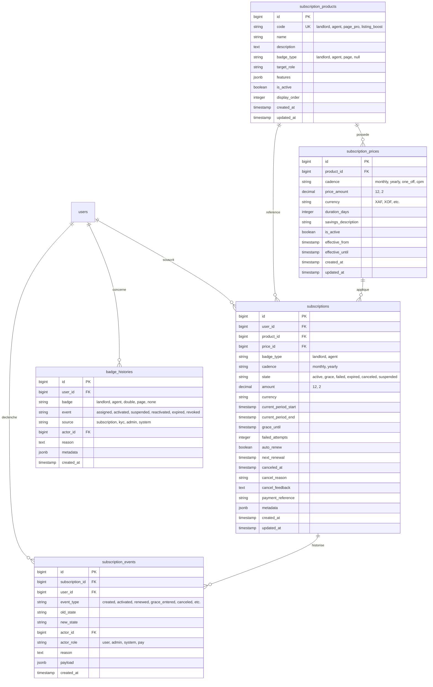

# BANGO — Schéma et Base de Données du Module SUB (PostgreSQL)

Ce document décrit en détail les tables, types, index, clés étrangères et contraintes PostgreSQL implémentés pour le module **SUB**.

---

## 1. Diagramme Entité-Relation

---

## 2. Dictionnaire des Données

### 2.1. Table `subscription_products`
Catalogue des produits et services proposés sur BANGO.

| Colonne | Type PostgreSQL | Nullable | Contraintes / Défaut | Description |
| :--- | :--- | :---: | :--- | :--- |
| `id` | `BIGSERIAL` | NON | `PRIMARY KEY` | Identifiant interne du produit |
| `code` | `VARCHAR(50)` | NON | `UNIQUE` | Slug unique machine (`landlord`, `agent`, etc.) |
| `name` | `VARCHAR(150)` | NON | - | Nom commercial affiché sur mobile |
| `description` | `TEXT` | OUI | - | Descriptif long des avantages |
| `badge_type` | `VARCHAR(30)` | OUI | - | Type de badge conféré (`landlord`, `agent`, `page`) |
| `target_role` | `VARCHAR(50)` | OUI | - | Rôle cible de l'offre |
| `features` | `JSONB` | OUI | - | Tableau JSON des puces d'avantages pour le mobile |
| `is_active` | `BOOLEAN` | NON | `DEFAULT TRUE` | Activation dans le catalogue public |
| `display_order` | `INTEGER` | NON | `DEFAULT 0` | Ordre de tri dans le tunnel d'achat |
| `created_at` | `TIMESTAMPTZ` | NON | `NOW()` | Date de création |
| `updated_at` | `TIMESTAMPTZ` | NON | `NOW()` | Date de dernière mise à jour |

**Index :**
- `idx_subscription_products_active_order` sur `(is_active, display_order)`

---

### 2.2. Table `subscription_prices`
Tarifications associées à un produit avec historisation temporelle.

| Colonne | Type PostgreSQL | Nullable | Contraintes / Défaut | Description |
| :--- | :--- | :---: | :--- | :--- |
| `id` | `BIGSERIAL` | NON | `PRIMARY KEY` | Identifiant du tarif |
| `product_id` | `BIGINT` | NON | `REFERENCES subscription_products(id) ON DELETE CASCADE` | Produit parent |
| `cadence` | `VARCHAR(30)` | NON | - | Cadence : `monthly`, `yearly`, `one_off`, `cpm` |
| `price_amount` | `NUMERIC(12, 2)` | NON | - | Montant financier exact (évite les pertes de float) |
| `currency` | `VARCHAR(4)` | NON | `DEFAULT 'XAF'` | Devise de référence |
| `duration_days` | `INTEGER` | NON | - | Durée de validité en jours (30, 365) |
| `savings_description` | `VARCHAR(255)` | OUI | - | Mention commerciale (ex: "2 mois offerts") |
| `is_active` | `BOOLEAN` | NON | `DEFAULT TRUE` | Tarif activé pour les nouvelles souscriptions |
| `effective_from` | `TIMESTAMPTZ` | NON | `NOW()` | Date d'entrée en vigueur |
| `effective_until` | `TIMESTAMPTZ` | OUI | `NULL` | Date d'expiration de l'offre tarifaire |
| `created_at` | `TIMESTAMPTZ` | NON | `NOW()` | Date de création |
| `updated_at` | `TIMESTAMPTZ` | NON | `NOW()` | Date de mise à jour |

**Index :**
- `idx_subscription_prices_lookup` sur `(product_id, is_active, cadence)`
- `idx_subscription_prices_effective` sur `(effective_from, effective_until)`

---

### 2.3. Table `subscriptions`
Abonnements souscrits par les utilisateurs.

| Colonne | Type PostgreSQL | Nullable | Contraintes / Défaut | Description |
| :--- | :--- | :---: | :--- | :--- |
| `id` | `BIGSERIAL` | NON | `PRIMARY KEY` | Identifiant de l'abonnement |
| `user_id` | `BIGINT` | NON | `REFERENCES users(id) ON DELETE CASCADE` | Titulaire de l'abonnement |
| `product_id` | `BIGINT` | NON | `REFERENCES subscription_products(id) RESTRICT` | Produit souscrit |
| `price_id` | `BIGINT` | NON | `REFERENCES subscription_prices(id) RESTRICT` | Tarif contractuel appliqué |
| `badge_type` | `VARCHAR(30)` | NON | - | Type de badge (`landlord`, `agent`) |
| `cadence` | `VARCHAR(30)` | NON | - | `monthly` ou `yearly` |
| `state` | `VARCHAR(30)` | NON | `DEFAULT 'active'` | `active`, `grace`, `failed`, `expired`, `canceled`, `suspended` |
| `amount` | `NUMERIC(12, 2)` | NON | - | Montant payé pour le cycle |
| `currency` | `VARCHAR(4)` | NON | `DEFAULT 'XAF'` | Devise de facturation |
| `current_period_start` | `TIMESTAMPTZ` | NON | - | Début du cycle contractuel actuel |
| `current_period_end` | `TIMESTAMPTZ` | NON | - | Fin du cycle contractuel actuel |
| `grace_until` | `TIMESTAMPTZ` | OUI | `NULL` | Échéance de grâce (+7j après impayé) |
| `failed_attempts` | `INTEGER` | NON | `DEFAULT 0` | Nombre de relances infructueuses |
| `auto_renew` | `BOOLEAN` | NON | `DEFAULT TRUE` | `false` si résiliation demandée à terme |
| `next_renewal` | `TIMESTAMPTZ` | OUI | `NULL` | Date prévue du prochain prélèvement |
| `canceled_at` | `TIMESTAMPTZ` | OUI | `NULL` | Date de la demande de résiliation |
| `cancel_reason` | `VARCHAR(255)` | OUI | `NULL` | Motif de départ (churn) |
| `cancel_feedback` | `TEXT` | OUI | `NULL` | Commentaire de l'utilisateur |
| `payment_reference` | `VARCHAR(150)` | OUI | `NULL` | Référence de la dernière transaction PAY |
| `metadata` | `JSONB` | OUI | `NULL` | Métadonnées extensibles |

**Index :**
- `idx_subscriptions_user_badge` sur `(user_id, badge_type)`
- `idx_subscriptions_user_state` sur `(user_id, state)`
- `idx_subscriptions_renewal` sur `(state, current_period_end)`
- `idx_subscriptions_grace` sur `(state, grace_until)`

---

### 2.4. Table `subscription_events`
Journal d'audit de cycle de vie (Append-Only).

| Colonne | Type PostgreSQL | Nullable | Description |
| :--- | :--- | :---: | :--- |
| `id` | `BIGSERIAL` | NON | Clé primaire |
| `subscription_id` | `BIGINT` | NON | Clé étrangère vers `subscriptions` |
| `user_id` | `BIGINT` | NON | Utilisateur concerné |
| `event_type` | `VARCHAR(50)` | NON | `created`, `activated`, `renewed`, `grace_entered`, `canceled`, `expired`, etc. |
| `old_state` | `VARCHAR(30)` | OUI | État précédent |
| `new_state` | `VARCHAR(30)` | OUI | Nouvel état |
| `actor_id` | `BIGINT` | OUI | Utilisateur ou admin déclencheur |
| `actor_role` | `VARCHAR(20)` | NON | `user`, `admin`, `system`, `pay` |
| `reason` | `TEXT` | OUI | Motif ou justification |
| `payload` | `JSONB` | OUI | Contexte de l'événement (prorata, montants, refs) |
| `created_at` | `TIMESTAMPTZ` | NON | Horodatage précis |

---

### 2.5. Table `badge_histories`
Traçabilité des badges visibles sur les profils.

| Colonne | Type PostgreSQL | Nullable | Description |
| :--- | :--- | :---: | :--- |
| `id` | `BIGSERIAL` | NON | Clé primaire |
| `user_id` | `BIGINT` | NON | Utilisateur porteur du badge |
| `badge` | `VARCHAR(30)` | NON | `landlord`, `agent`, `double`, `page`, `none` |
| `event` | `VARCHAR(30)` | NON | `assigned`, `activated`, `suspended`, `reactivated`, `expired`, `revoked` |
| `source` | `VARCHAR(30)` | NON | `subscription`, `kyc`, `admin`, `system` |
| `actor_id` | `BIGINT` | OUI | Acteur à l'origine du changement |
| `reason` | `TEXT` | OUI | Justification textuelle |
| `metadata` | `JSONB` | OUI | Détails (couleur d'anneau, ancien badge) |
| `created_at` | `TIMESTAMPTZ` | NON | Horodatage de l'événement |
